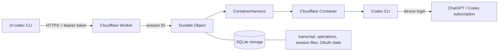

# cf-codex

Run selected [OpenAI Codex CLI](https://developers.openai.com/codex/cli/) sessions in [Cloudflare Containers](https://developers.cloudflare.com/containers/) without replacing your normal local Codex workflow.

Use local Codex by default. Reach for `cf-codex` when a task may take a while, you want to close your laptop, or you want an isolated remote environment:

```bash
# Normal local workflow remains unchanged
codex

# Explicitly send one task to Cloudflare
cf-codex start \
  --repo https://github.com/OWNER/REPOSITORY.git \
  "Investigate the failing tests, fix the cause, and run the relevant test suite."
```

After setup and browser authentication, the command submits the task and returns. The remote container keeps working when your terminal disconnects.

> [!WARNING]
> Cloudflare's Container harness is experimental. This project also persists a Codex OAuth credential so a session can survive container replacement. Read [Security](#security) and [Limitations](#limitations) before using it with important code or accounts.

## Why

Local coding agents are great until a task is long-running or you need to step away. Moving every Codex session to the cloud is unnecessary, but having an explicit remote option is useful.

`cf-codex` follows three rules:

1. **Local stays the default.** It does not replace, alias, or reconfigure `codex`.
2. **Remote work is explicit.** Only `cf-codex start` creates a Cloudflare session.
3. **Use the Codex subscription flow.** Each remote session uses Codex device login instead of configuring a separately billed OpenAI API key.

Usage is still subject to your ChatGPT/Codex plan limits, and Cloudflare Workers, Durable Objects, and Containers may have their own charges.

## What it does

- Creates one Durable Object and Cloudflare Container identity per remote session.
- Installs and runs the real Codex CLI in a Debian container.
- Authenticates each session with `codex login --device-auth`.
- Stores session history, operations, and Codex session files in Durable Object storage.
- Persists refreshed OAuth credentials across container replacement.
- Submits prompts asynchronously, so the client can disconnect after submission.
- Streams concise progress and final responses without dumping tool payloads.
- Remembers the most recently used session and operation locally.
- Clones public Git repositories and optionally checks out a requested ref.
- Includes Node.js, Go 1.26, and a C/C++ build toolchain.
- Stops idle containers after 15 minutes; containers can also be stopped explicitly.

## Architecture



The Worker authenticates and routes requests. The Durable Object owns durable session state. The container supplies the Linux environment where Codex runs commands.

`ContainerHarness` snapshots an idle container and can restore it later. Codex's session files and the file-backed OAuth credential are mirrored into Durable Object storage so a replacement container can resume the session.

## Status

This is an early project built on experimental Cloudflare APIs.

Currently supported:

- Public repositories
- Interactive ChatGPT device login
- Asynchronous prompts and follow-up prompts
- Status, messages, event streaming, waiting, aborting, and stopping
- Node.js and Go projects
- Local development with Docker

Not yet supported:

- Local-to-remote session handoff
- Private repository credentials
- Automatic commits, pushes, or pull requests
- Listing all server-side sessions
- Multi-user authentication or authorization
- Deleting Durable Object session data through the CLI
- A configurable per-project toolchain

## Prerequisites

- A [Cloudflare account](https://dash.cloudflare.com/sign-up) with Containers access
- A Cloudflare plan that supports the required Workers and Containers usage
- [Node.js](https://nodejs.org/) 24.22 or newer
- [Docker](https://docs.docker.com/get-docker/) for local container development
- A ChatGPT plan that includes Codex
- Device-code login enabled in your ChatGPT security or workspace settings

Useful references:

- [Cloudflare Codex harness](https://developers.cloudflare.com/agents/harnesses/codex/)
- [Cloudflare Containers](https://developers.cloudflare.com/containers/)
- [Cloudflare Durable Objects](https://developers.cloudflare.com/durable-objects/)
- [Cloudflare CLI setup](https://developers.cloudflare.com/cf/get-started/)
- [OpenAI Codex authentication](https://developers.openai.com/codex/auth)
- [Cloudflare Containers pricing](https://developers.cloudflare.com/containers/platform/pricing/)

## Quick start

### 1. Install

```bash
git clone <YOUR-FORK-OR-REPOSITORY-URL>
cd cf-codex

nvm use
node --version  # must be v24.22.0 or newer
npm install
```

If another Node installation remains earlier on your `PATH`:

```bash
export PATH="$HOME/.nvm/versions/node/v24.22.0/bin:$PATH"
```

### 2. Create the service access token

This token protects the deployed `cf-codex` HTTP API. It is **not** a Cloudflare deployment token and it is **not** a Codex credential.

```bash
umask 077
printf 'CF_CODEX_API_TOKEN="%s"\n' "$(openssl rand -hex 32)" > .dev.vars
```

`.dev.vars` is ignored by Git. Do not commit or share it.

### 3. Authenticate the Cloudflare CLI

```bash
npx cf auth login
npx cf auth whoami
```

The Cloudflare CLI login authorizes deployment. It is separate from `CF_CODEX_API_TOKEN`, which authorizes calls to the deployed application.

### 4. Deploy

```bash
npm run deploy
```

The command runs:

```bash
cf deploy --secrets-file .dev.vars
```

It builds the Worker, deploys the Durable Object and container configuration, and uploads `CF_CODEX_API_TOKEN` as an encrypted Worker secret. The output includes a URL similar to:

```text
https://cf-codex.<YOUR_WORKERS_SUBDOMAIN>.workers.dev
```

### 5. Install and configure the CLI

```bash
npm link

set -a
. ./.dev.vars
set +a

cf-codex configure \
  --url https://cf-codex.<YOUR_WORKERS_SUBDOMAIN>.workers.dev \
  --token "$CF_CODEX_API_TOKEN"

unset CF_CODEX_API_TOKEN
```

Configuration is stored with file mode `0600` at:

```text
~/.config/cf-codex/config.json
```

`CF_CODEX_URL` and `CF_CODEX_TOKEN` environment variables override the saved values.

### 6. Start remote work

```bash
cf-codex start \
  --repo https://github.com/OWNER/REPOSITORY.git \
  --ref main \
  "Find the cause of the failing integration tests, fix it, and run the relevant tests."
```

On a new session, Codex prints a browser URL and one-time device code. Enter that code on the OpenAI page. Do not paste the code into another terminal or share it with anyone.

After login, `cf-codex` prints a session ID and operation ID, then returns control to your shell.

## Common workflows

### Check a long-running task

```bash
cf-codex status
cf-codex logs
```

`logs` follows an active task. Pressing `Ctrl-C` only stops watching; it does not stop the remote operation. If the task is already idle, `logs` prints the latest response and exits.

### Wait for the final response

```bash
cf-codex wait
```

`wait` intentionally blocks until the latest operation finishes. Use JSON for scripts:

```bash
cf-codex wait --json
```

### Send a follow-up prompt

```bash
cf-codex prompt "Now add a regression test for the bug."
```

To target a specific session:

```bash
cf-codex prompt cx_0123456789abcdef0123456789abcdef \
  "Explain why the fix is safe."
```

### Pipe a prompt through stdin

```bash
printf '%s\n' "Review the parser for edge cases" | \
  cf-codex start --repo https://github.com/OWNER/REPOSITORY.git
```

### Abort work

```bash
cf-codex abort
```

This asks the active Codex operation to stop.

### Stop the container

```bash
cf-codex stop
```

The command acknowledges immediately. Snapshot and container cleanup continue remotely. Stopping a container does not delete the Durable Object transcript or Codex session state; a later prompt can start a fresh container and resume.

## Command reference

| Command | Purpose | Foreground behavior |
|---|---|---|
| `cf-codex configure --url URL --token TOKEN` | Save the service endpoint and access token | Returns immediately |
| `cf-codex start [prompt] [--repo URL] [--ref REF]` | Create, authenticate, and submit a remote session | Waits for setup and device login; returns after submission |
| `cf-codex login [session]` | Reauthenticate an existing running session | Waits for device login |
| `cf-codex auth [session]` | Check Codex authentication | Returns immediately |
| `cf-codex prompt [session] [prompt]` | Submit follow-up work | Returns after submission |
| `cf-codex status [session]` | Show concise container and operation status | Returns immediately |
| `cf-codex messages [session]` | Show conversation text | Returns immediately |
| `cf-codex logs [session]` | Follow concise session events | Follows while active; exits when already idle |
| `cf-codex wait [session] [operation]` | Wait for and print the final response | Blocks until completion |
| `cf-codex abort [session]` | Interrupt the active operation | Returns after the abort request |
| `cf-codex stop [session]` | Request container snapshot and shutdown | Returns immediately |

Most commands use the latest session and operation when IDs are omitted. Add `--json` where supported for machine-readable output.

## Run locally

Start Docker, then run:

```bash
npm run dev
```

The first run downloads the Cloudflare development container image. In another terminal, use environment overrides so you do not replace your deployed CLI configuration:

```bash
set -a
. ./.dev.vars
set +a

CF_CODEX_URL=http://localhost:5173 \
CF_CODEX_TOKEN="$CF_CODEX_API_TOKEN" \
cf-codex start "Create hello.txt containing hi, then read it back."
```

The first session is slow because the harness installs Codex, Go, and build tools, then creates a reusable setup snapshot.

## Session lifecycle

1. `start` creates a random session ID.
2. The Worker routes that ID to a named Durable Object.
3. The Durable Object starts and prepares its container.
4. You complete Codex device authentication.
5. The prompt is stored and submitted asynchronously.
6. Codex works inside the container and emits durable events.
7. After 15 minutes of inactivity, the harness snapshots and stops the container.
8. A later prompt restores the session in a new container.

A separate `start` command creates a separate Durable Object and container identity. Follow-up `prompt` commands reuse an existing session.

Important lifecycle details:

- A normal stop preserves session history and mirrored Codex state.
- Files written after the most recent container snapshot can be lost if the container crashes.
- Repository changes are not pushed anywhere automatically.
- Changing the container setup takes effect when a container next starts. Existing running containers keep their old setup until stopped.

## Toolchain

The managed container setup currently installs:

- Codex CLI `0.157.0`
- Git and CA certificates from the Cloudflare base setup
- Go `1.26.11`
- `build-essential`, `curl`, and `pkg-config`
- Node.js from the Cloudflare Debian container image

Versions are pinned in `src/index.ts`. The Go archive is verified with its published SHA-256 checksum.

To add project-specific tools, add a setup step in `subscriptionCodex()`. Changing setup invalidates the reusable setup snapshot, so the next container start will rebuild it.

## Security

This project deliberately runs an autonomous coding agent with shell access and outbound internet access. Treat that as a meaningful security boundary, not as a harmless chatbot.

### Service access token

Every session route requires:

```http
Authorization: Bearer <CF_CODEX_API_TOKEN>
```

Anyone with this token can run commands in your containers and consume your Cloudflare and Codex allowances. Use a long random value, keep `.dev.vars` private, and rotate the token if it leaks.

The bearer token is currently a single-user shared secret. There is no per-user identity, rate limit, or role system.

### Codex subscription credential

Each session runs `codex login --device-auth`. Codex stores an OAuth credential in `auth.json`. This project mirrors that file into Durable Object storage so refreshed tokens survive container replacement.

Consequences:

- Codex and commands launched by Codex can read the credential file.
- Session storage contains sensitive account material and transcripts.
- Stopping a container does not delete that Durable Object data.
- A malicious prompt, repository, dependency, or tool output could attempt to exfiltrate data.

Cloudflare encrypts Durable Object storage at rest, but encryption at rest does not make an agent-readable credential harmless. Use a dedicated account or managed workspace policy if your risk model requires stronger isolation.

### Container permissions

The container is the sandbox. Codex runs without its usual approval prompts inside it and can execute commands or make network requests. It does not receive your local filesystem, local Codex credentials, or Cloudflare deployment credentials.

Only public repository cloning is intentionally supported. Do not add long-lived GitHub tokens to setup commands, container environment variables, snapshots, prompts, or `AGENTS.md`.

### Logs and output

Human-readable `status` and `logs` output is compact. `--json` and the messages API can contain repository content, commands, tool results, and model output. Review logs before sharing them.

## Costs

This project avoids configuring an OpenAI API key. Codex model usage goes through the ChatGPT account authenticated by device login and is subject to that plan's limits.

You can still incur Cloudflare costs for:

- Workers requests
- Durable Object requests, compute, and SQLite storage
- Container CPU, memory, disk, and network usage

See [Cloudflare Containers pricing](https://developers.cloudflare.com/containers/platform/pricing/) and the pricing pages for Workers and Durable Objects. Explicitly stop completed sessions when you do not want to wait for the idle timeout:

```bash
cf-codex stop
```

## HTTP API

The CLI uses these authenticated routes:

```text
POST /v1/sessions
GET  /v1/sessions/:session
POST /v1/sessions/:session/login
GET  /v1/sessions/:session/auth
POST /v1/sessions/:session/prompt
GET  /v1/sessions/:session/events
GET  /v1/sessions/:session/messages
GET  /v1/sessions/:session/operations/:operation
POST /v1/sessions/:session/abort
POST /v1/sessions/:session/stop
```

`GET /` is an unauthenticated health check and does not expose session data.

## Development

```bash
npm run typecheck
npm test
npm run check
```

For local integration testing:

```bash
npm run dev
```

For deployment:

```bash
npm run deploy
```

The deployment command uses the Cloudflare identity established by `cf auth login`. The random token in `.dev.vars` is uploaded as an application secret; it does not grant Cloudflare deployment access.

## Troubleshooting

### `cf-codex login` says a session ID is required

`login` reauthenticates an existing session. Use `cf-codex start` to create a session; `start` performs the initial login automatically.

### `start` stays on “Preparing a remote Codex container”

The first setup installs Codex and the development toolchain and may take several minutes. Later starts can reuse a setup snapshot. If preparation exceeds the setup timeout, inspect the Worker and Container logs in the Cloudflare dashboard.

### Browser login succeeds but the terminal keeps waiting

The CLI polls `auth` independently and should continue once Codex reports `Logged in using ChatGPT`. Ensure you are running the current linked CLI, then retry the existing session with `cf-codex login SESSION_ID` if needed.

### A session uses an older toolchain

Setup changes apply on the next container start:

```bash
cf-codex stop SESSION_ID
cf-codex prompt SESSION_ID "Retry the task and run the relevant tests."
```

### `node --version` is not the version selected by `nvm`

Another Node installation may be earlier on `PATH`:

```bash
export PATH="$HOME/.nvm/versions/node/v24.22.0/bin:$PATH"
```

## Limitations

- Cloudflare's harness APIs and programmatic configuration are experimental and may change.
- The OAuth persistence technique relies on Codex file-based credentials and the harness's mirrored Codex session directory.
- Device authentication is required for every newly created remote session.
- The service is designed for one trusted operator, not public multi-tenant hosting.
- Public repository support does not include authenticated pushes.
- Container snapshots are convenient persistence, not a source-control or backup system.
- The project does not currently delete Durable Object state or revoke ChatGPT sessions automatically.
- Only the Linux AMD64 Go archive is installed.

## License

Licensed under the [MIT License](LICENSE).
